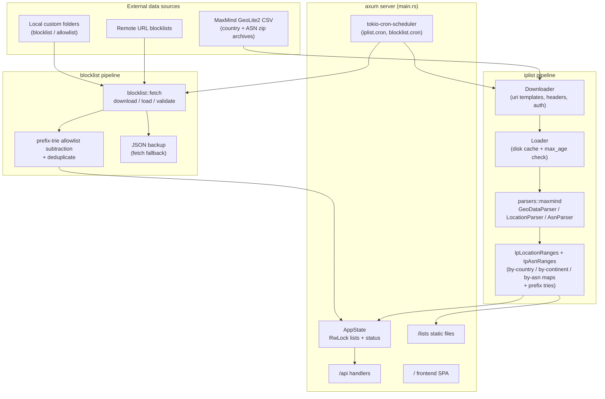
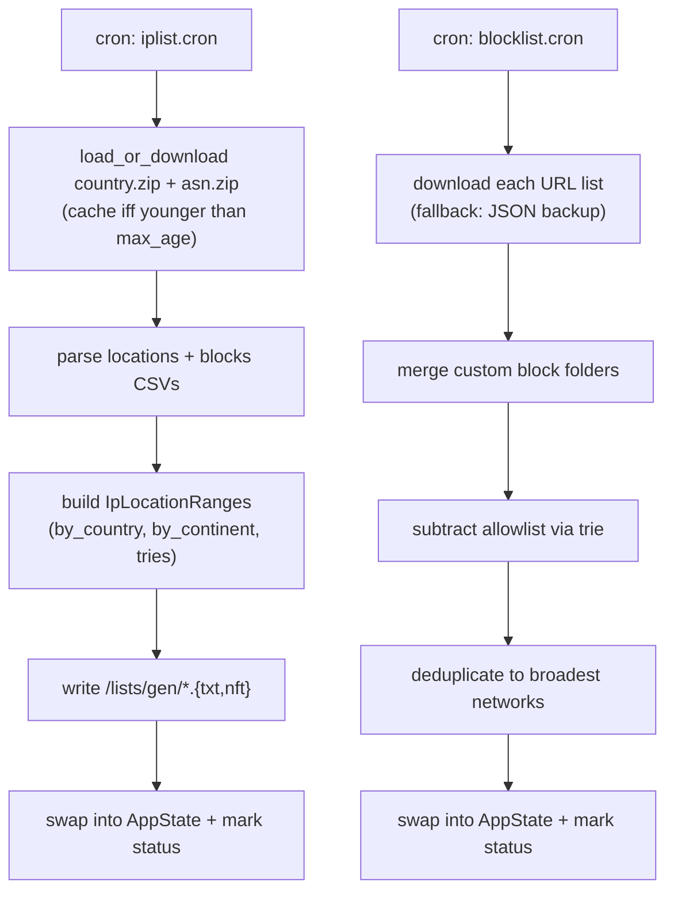
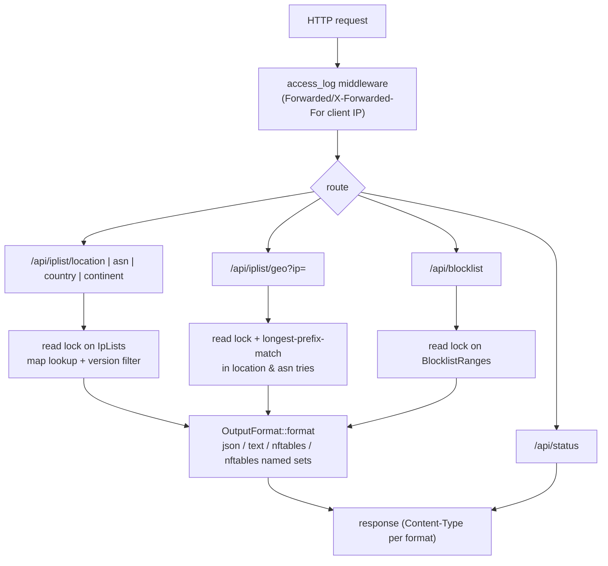

# iplists

A small Rust/axum service that periodically downloads **GeoIP (country/continent) and ASN IP
prefix data** and **remote/local IP blocklists**, keeps them in memory for millisecond-fast
lookups, and serves them over an HTTP API and as generated list files

- as plain text (one CIDR per line),
- as JSON,
- as **nftables** `define` snippets or ready-to-`include` named sets.

A bundled single-page UI (served from `frontend/dist`) makes the data browsable, and a
`/api/status` endpoint reports the health and refresh schedule of every pipeline.

---

## Table of contents

- [Features](#features)
- [Architecture](#architecture)
  - [Module map](#module-map)
  - [Refresh pipelines](#refresh-pipelines)
  - [Request flow](#request-flow)
- [HTTP API](#http-api)
- [Generated files](#generated-files)
- [Configuration](#configuration)
- [Running](#running)
- [Development](#development)
  - [Project layout](#project-layout)
  - [Adding a new data source (parser)](#adding-a-new-data-source-parser)
  - [Adding a new output format](#adding-a-new-output-format)
  - [Tests & docs](#tests--docs)

---

## Features

- **GeoIP lists** — networks per country and per continent, plus single-IP geo lookups.
- **ASN lists** — networks per autonomous system, merged into the same geo lookup.
- **Blocklist aggregation** — merge any number of remote URL lists and local folders,
  subtract an allowlist (with true CIDR set subtraction, not just literal removal),
  and deduplicate overlaps into the broadest possible networks.
- **Multiple output formats** — JSON, plain text, nftables `define` blocks, and nftables
  named sets for every list endpoint.
- **Scheduled refreshes** — cron-driven (6-field cron expressions, seconds required) with a
  local on-disk cache that bounds re-downloads (`max_age`) and backs up remote blocklists
  for offline fallback.
- **Operational visibility** — per-component health (`ok`/`warning`/`error`/`disaster`),
  last/next refresh timestamps at `/api/status`, Apache-style access logs, optional TLS,
  multi-address binding.

## Architecture



### Module map

| Module | Responsibility |
|---|---|
| `main.rs` | CLI, `AppState`, router setup, TLS/binding, cron scheduling, startup refresh |
| `config.rs` | `AppConfig`: YAML/TOML file + `APP_*` env overrides |
| `error.rs` | `AppError`, `From` conversions for every subsystem, JSON error responses |
| `status.rs` | `AppStatus`/component health, worst-status aggregation, next-run cron math |
| `list.rs` | `IpLists` container + `update_ranges` refresh orchestration |
| `iptools/` | generic IP toolkit: `ListNetwork`/`Splitable` traits and the binary prefix trie (`IPTrie`) |
| `iplist/config.rs` | geo/ASN download settings (uris, timeout, max_age, headers, output folder, cron) |
| `iplist/fetch.rs` | `Downloader` → `Saver` → `Loader` cache chain, `GeoDataParser` trait |
| `iplist/iprange.rs` | core model (`Location`, `IpLocationRange`, `IpAsnRange`), index structs, file generation |
| `iplist/parsers/` | provider adapters (`maxmind` today) — *the extension point for data sources* |
| `iplist/formatter.rs` | `OutputFormat` rendering + HTTP responses — *the extension point for output formats* |
| `blocklist/` | remote/custom blocklist fetching, allowlist subtraction, dedup, JSON backups |
| `handlers/` | axum handlers for `/api/*` |
| `forms/` | query/form types and uniform-error extractors |
| `models/` | response DTOs (geo lookup result) |
| `utils/` | proxy-aware client-IP extraction for the access log |

### Refresh pipelines

Both pipelines run **once at startup** (before listeners come up) and then **on their own
cron schedules**. Failures never tear down existing data — they only degrade the component
status reported by `/api/status`:



### Request flow



## HTTP API

All endpoints are `GET` and live under `/api`. Unless noted otherwise, list endpoints accept
`?format=Json|Text|Nftables|NftablesNamedSets` (default `Json`, case-sensitive).

| Endpoint | Query parameters | Description |
|---|---|---|
| `/api/iplist/country` | — | Full location table (`[{id, name, code, continent}]`). |
| `/api/iplist/continent` | — | Distinct continent names. |
| `/api/iplist/location` | `country=DE` / `continent=Europe`, `version=ipv4\|ipv6`, `format=...` | Networks for a country or continent; both absent returns everything. The `country`/`continent` value is used as the nftables set name. |
| `/api/iplist/asn` | `asn=13335`, `version=ipv4\|ipv6`, `format=...` | Networks for one ASN (set name `asn13335`); absent returns everything. |
| `/api/iplist/geo` | `ip=1.2.3.4` (required) | Single-IP lookup: `{ip, network, asn, isp, location}`. 404 if the IP matches neither location nor ASN data. |
| `/api/blocklist` | `version=ipv4\|ipv6`, `format=...` | The merged, allowlist-subtracted, deduplicated blocklist (set name `blocklist`). |
| `/api/status` | — | Component health + last/next refresh timestamps; `overall` is the worst component status. |

Examples:

```bash
curl 'http://localhost:8000/api/iplist/location?country=DE&format=Text'
curl 'http://localhost:8000/api/iplist/location?continent=Europe&format=NftablesNamedSets'
curl 'http://localhost:8000/api/iplist/geo?ip=8.8.8.8'
curl 'http://localhost:8000/api/blocklist?version=ipv4&format=Nftables'
```

## Generated files

On every successful geo refresh, per-country and per-continent files are written under
`<iplist.output_folder>/gen/` and served statically at `/lists/gen/`:

```
lists/gen/DE.txt            # v4 + v6, one CIDR per line
lists/gen/DE-ipv4.txt       # v4 only
lists/gen/DE-ipv6.txt       # v6 only
lists/gen/DE.nft            # nftables defines (both families)
lists/gen/DE-ipv4.nft
lists/gen/DE-ipv6.nft
lists/gen/Europe.txt        # same set for continents
...
```

Blocklist downloads are additionally backed up as JSON at their configured `backup_path` and
automatically reused when a remote source is unreachable.

## Configuration

Configuration is a YAML (or TOML) file — default path `iplists.yaml`, override with
`-c/--config` — layered with `APP_*` environment variables (e.g. `APP_IPLIST__CRON=...`).
See [`iplists-example.yaml`](iplists-example.yaml) for a fully annotated example.

```yaml
hostnames: ["[::]:8000"]        # listeners (DNS names allowed); multiple entries bind all
workers: 16                     # tokio threads; default = CPU cores
app_log_level: info             # crate log level
all_log_level: info             # everything else
tls_cert_path: /path/fullchain.pem   # both set => HTTPS
tls_key_path:  /path/privkey.pem

iplist:
  country_uri: https://download.maxmind.com/geoip/databases/GeoLite2-Country-CSV/download?suffix=zip
  asn_uri:     https://download.maxmind.com/geoip/databases/GeoLite2-ASN-CSV/download?suffix=zip
  output_folder: lists          # archives cached in <folder>/download/
  cron: "0 0 * * * *"           # 6 fields, seconds first; hourly at minute 0
  max_age: 12h                  # re-download archives older than this
  timeout: 10s                  # HTTP timeout
  # headers: {Authorization: "Bearer ..."}
  # basic_auth: {username: ..., password: ...}

blocklist:
  cron: "* * * * * *"           # every minute
  custom_blocklist:
    ipv4_folder: lists/custom/blocklist/ipv4
    ipv6_folder: lists/custom/blocklist/ipv6
    # split_string: ","          # default: any whitespace
  custom_allowlist:
    ipv4_folder: lists/custom/allowlist/ipv4
    ipv6_folder: lists/custom/allowlist/ipv6
  url_blocklist:
    - name: my-list
      ipv4_url: "https://example.org/v4.txt"
      ipv6_url: "https://example.org/v6.txt"
      backup_path: lists/backup/blocklist.json
      timeout: 10s
      # split_string: ","
      # error_on_empty: true     # fail loudly instead of clearing the list
```

Notes:

- Download URIs support `{year}`/`{month}`/`{day}` placeholders, expanded with the current
  local date — useful for date-stamped feeds.
- Invalid CIDRs in any list are skipped with a warning; entries whose address isn't the
  network base (e.g. `10.0.0.1/8`) are rejected to avoid silent over-blocking.

## Running

```bash
# config at ./iplists.yaml (copy iplists-example.yaml)
cargo run --release              # or: cargo run --release -- -c /etc/iplists.yaml
```

A multi-stage [`Dockerfile`](Dockerfile) (cargo-chef cached Rust build + SPA build) is
provided; the container serves the UI, `/api/*`, and `/lists/*`. The working directory must
contain `iplists.yaml` and is expected to contain `frontend/dist` for the SPA (pre-built
assets are bundled in the image).

## Development

### Project layout

```
src/
├── main.rs               # AppState, router, cron jobs, startup
├── config.rs  error.rs  status.rs  list.rs
├── iptools/              # ListNetwork / Splitable traits, prefix trie
├── iplist/               # geo/ASN pipeline
│   ├── config.rs  fetch.rs  iprange.rs
│   ├── formatter.rs      # output formats (extension point)
│   └── parsers/          # data providers (extension point)
│       └── maxmind.rs
├── blocklist/            # blocklist pipeline
├── handlers/ forms/ models/ utils/
frontend/                 # SPA source (built into frontend/dist)
benchmarking/             # trie benchmark binary
```

### Adding a new data source (parser)

Everything provider-specific lives behind three traits. To add e.g. an RIR-stats provider:

1. **Create `src/iplist/parsers/<provider>.rs`** and register it in
   [`src/iplist/parsers/mod.rs`](src/iplist/parsers/mod.rs) with `pub mod <provider>;`.

2. **Implement
   [`GeoDataParser`](src/iplist/fetch.rs)** for a wrapper around the downloaded bytes:

   ```rust
   pub struct MyGeoData { body: Vec<u8> }

   impl GeoDataParser for MyGeoData {
       fn new(body: Vec<u8>) -> Self { Self { body } }

       async fn parse<T: for<'de> Deserialize<'de>>(&self, name: &str)
           -> Result<Vec<T>, AppError>
       {
           // deserialize file `name` inside `self.body` (zip/csv/json/...)
       }
   }
   ```

   `GeoDataParser::new` takes raw bytes, so `Downloader` (HTTP + uri templates) and `Loader`
   (disk cache enforcing `max_age`) — including the `load_or_download` helper pattern from
   `maxmind.rs` — work for the new provider unchanged.

3. **Map provider rows into the crate model** and implement
   [`LocationParser` + `AsnParser`](src/iplist/iprange.rs):

   ```rust
   pub struct MyParser;

   impl LocationParser for MyParser {
       async fn locations(config: &IplistConfig) -> Result<Vec<Location>, AppError> { /* ... */ }
       async fn location_ranges(
           config: &IplistConfig,
           locations: &[Location],
       ) -> Result<Vec<IpLocationRange>, AppError> { /* ... */ }
   }

   impl AsnParser for MyParser {
       async fn asn_ranges(config: &IplistConfig) -> Result<Vec<IpAsnRange>, AppError> { /* ... */ }
   }
   ```

   `Location.id` is the join key between the location table and the network blocks
   (MaxMind's `geoname_id`). Keep `Location.code` as the ISO alpha-2 country code and
   `continent` as the continent name — the indexes key off both.

4. **Plug it in**: replace `update_ranges::<MaxMindParser>(...)` with
   `update_ranges::<MyParser>(...)` in [`src/main.rs`](src/main.rs) (both the startup call
   and the cron job in `schedule_tasks`). Indexing, file generation, the HTTP handlers and
   status reporting are generic and need no changes.

5. Optionally add the provider's URIs to your config's `iplist:` section and adjust defaults
   in [`src/iplist/config.rs`](src/iplist/config.rs).

### Adding a new output format

Formats are independent of parsers and live entirely in
[`src/iplist/formatter.rs`](src/iplist/formatter.rs):

1. **Add a variant** to `OutputFormat` (serde's enum deserialization makes it available as a
   `?format=` value immediately):

   ```rust
   pub enum OutputFormat {
       #[default]
       Json,
       Text,
       Nftables,
       NftablesNamedSets,
       Ipv4Ranges,   // <- new
   }
   ```

2. **Render it** in `OutputFormat::format(&self, data, set_name)`. Items implement
   [`ListNetwork`](src/iptools/network.rs) (`network_string()`, `is_ipv4()`, …) plus
   `Serialize`, so text-like formats iterate with `network_string()` and structured formats
   can serde-serialize the items directly:

   ```rust
   OutputFormat::Ipv4Ranges => FormattedOutput::new(
       data.iter()
           .filter(|ip| ip.is_ipv4())
           .map(|ip| ip.network_string())
           .collect::<Vec<_>>()
           .join("\n"),
       OutputFormat::Ipv4Ranges,
   ),
   ```

3. **Set the `Content-Type`** for HTTP responses in the `IntoResponse` impl of
   `FormattedOutput` (plain text needs nothing — axum's default is fine):

   ```rust
   OutputFormat::Json => (
       [(header::CONTENT_TYPE, HeaderValue::from_static("application/json"))],
       self.output,
   ).into_response(),
   ```

That's it — every list endpoint (`/api/iplist/*`, `/api/blocklist`) now accepts the new
`?format=` value. If the format should also be written to disk during refreshes, add
`save_data(...)` calls with it in
[`IpLocationRanges::save`](src/iplist/iprange.rs).

### Tests & docs

```bash
cargo test           # prefix-trie subtraction/dedup tests in src/iptools/iptrie.rs
cargo clippy         # lints
cargo doc --open     # full rustdoc incl. per-module extension guides
```
